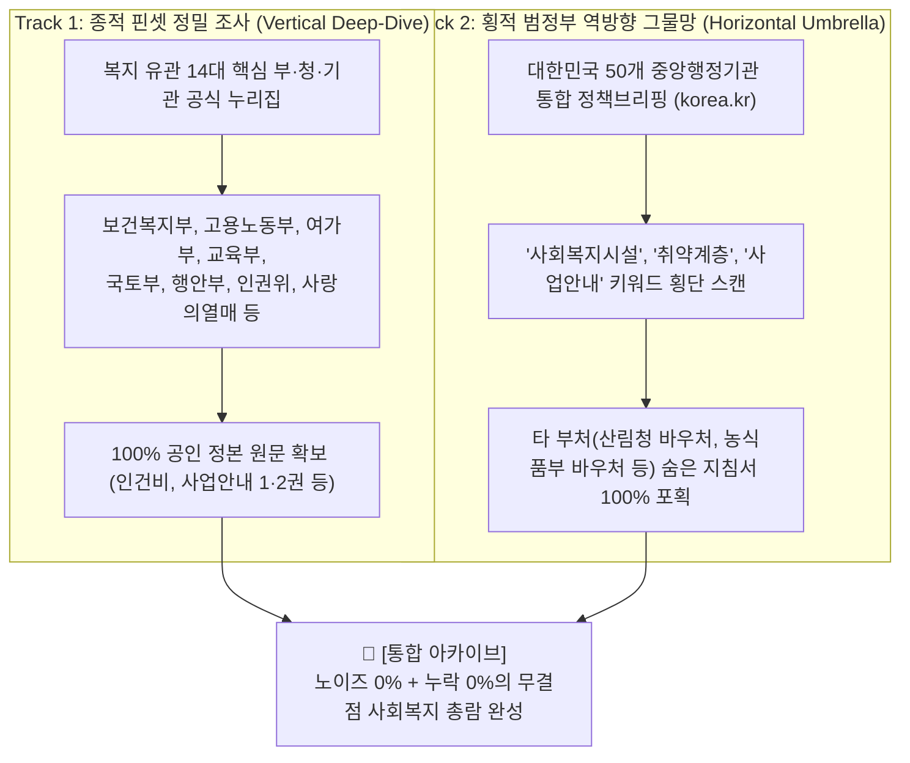
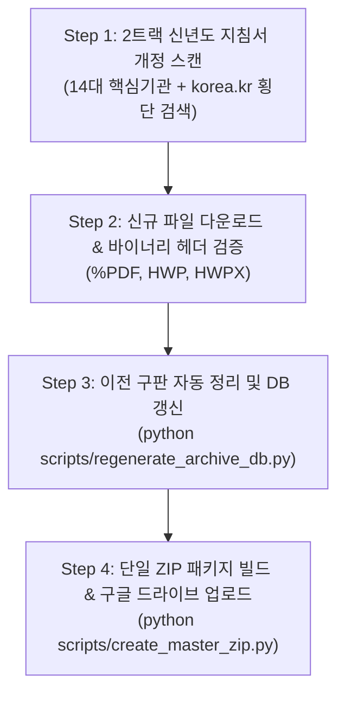

# 🧭 대한민국 사회복지 공식 지침서·사업안내 연례 갱신 매뉴얼 및 소관처 총람

> **문서 버전**: 2026.11 개정판  
> **최종 정비 일자**: 2026년 11월 15일  
> **문서 목적**: 매년 1~3월 정부부처 및 공공기관의 사회복지 지침서·사업안내가 개정될 때, 담당자 및 AI 에이전트가 헤매지 않고 **동일한 공식 소관처와 직통 URL에서 최신 개정판을 즉시 탐색·수집·검증·배포**할 수 있도록 표준 절차와 출처 레지스트리를 총람합니다.

---

## 📌 목차
1. [법정 시설 분류 및 지침서 100% 매칭 총람표](#1-법정-시설-분류-및-지침서-100-매칭-총람표)
2. [10대 정부부처 및 14대 공식 출처 직통 레지스트리](#2-10대-정부부처-및-14대-공식-출처-직통-레지스트리)
3. [『사각지대 제로형 2트랙 (종적 핀셋 + 횡적 그물망)』 조사 방법론](#3-사각지대-제로형-2트랙-종적-핀셋--횡적-그물망-조사-방법론)
4. [연례 정기 갱신 표준 프로토콜 (Checklist)](#4-연례-정기-갱신-표준-프로토콜-checklist)
5. [자동화 갱신 및 배포 스크립트 사용 가이드](#5-자동화-갱신-및-배포-스크립트-사용-가이드)

---

## 1. 법정 시설 분류 및 지침서 100% 매칭 총람표

『2026 사회복지시설 관리안내』(보건복지부) 및 관련 개별 법령에 규정된 **모든 법정 사회복지시설군에 대해 총 53개 최신 정본 문서가 1:1 완벽 매칭**되어 있습니다.

| 번호 | 법정 시설 및 지원 체계 | 근거 법령 | 소관 부처 | 아카이브 수록 최신 정본 파일명 |
| :---: | :--- | :--- | :---: | :--- |
| **01** | **사회복지시설 공통 기준** | 「사회복지사업법」 | 보건복지부 | `01_사회복지시설_관리안내_공통_2026.pdf` |
| **02** | **종사자 인건비 기준** | 「사회복지사업법」 | 보건복지부 | `00_사회복지시설_종사자_인건비가이드라인_2026.hwpx` |
| **03** | **사회복지법인** | 「사회복지사업법」 | 보건복지부 / 협회 | `00_사회복지법인_관리안내_2026_2026년_사회복지법인_관리안내.pdf` |
| **04** | **사회복지관 (종합)** | 「사회복지사업법」 제34조의5 | 보건복지부 | `02_사회복지관_운영관련_업무처리안내_종합복지관3대기능_2026.pdf` |
| **05** | **사회복지관 ESG 실천** | 민간/협회 표준 | 한국사회복지관협회 | `01_사회복지관_ESG_실천가이드_한국사회복지관협회.pdf` |
| **06** | **자원봉사관리센터 (VMS)** | 「사회복지사업법」 제9조 | 보건복지부 / 한사협 | `00_사회복지자원봉사_사업지침_VMS_2026.pdf` |
| **07** | **노인주거·의료·여가·재가복지** | 「노인복지법」 제31조~제39조 | 보건복지부 | `03_노인보건복지사업안내_1권_2026.pdf` `03_노인보건복지사업안내_2권_2026.pdf` |
| **08** | **노인맞춤돌봄서비스** | 「노인복지법」 제27조의2 | 보건복지부 | `03_노인맞춤돌봄서비스_사업안내_2026_첨부1.hwpx` `03_노인맞춤돌봄서비스_사업안내_2026_첨부2.pdf` |
| **09** | **노인일자리지원기관** | 「노인복지법」 제23조의2 | 한국노인인력개발원 | `03_노인일자리_및_사회활동지원사업_운영안내_2026.pdf` |
| **10** | **장애인 거주·지역사회재활시설** | 「장애인복지법」 제58조 | 보건복지부 | `05_장애인복지사업안내_2026_첨부1.pdf` `05_장애인복지사업안내_2026_첨부2.hwp` |
| **11** | **발달장애인지원센터** | 「발달장애인법」 제33조 | 보건복지부 / 장애인개발원 | `05_발달장애인지원센터_사업안내_2026_첨부1.pdf` `05_발달장애인지원센터_사업안내_2026_첨부2.hwpx` |
| **12** | **장애인활동지원기관** | 「장애인활동지원법」 제20조 | 보건복지부 | `05_장애인활동지원_사업안내_2026.pdf` |
| **13** | **장애인일자리 수행기관** | 「장애인복지법」 제21조 | 보건복지부 / 협회 | `05_장애인일자리_사업안내_2026.pdf` |
| **14** | **장애인 직업능력개발원** | 「장애인고용촉진법」 | 고용노동부 / 공단 | `01_장애인_직업능력개발원_사업_업무매뉴얼_한국장애인고용공단.pdf` |
| **15** | **국민취업지원 (고용복지안전망)** | 「구직자취업촉진법」 | 고용노동부 | `01_국민취업지원제도_업무매뉴얼_2026.pdf` |
| **16** | **아동양육·일시보호·자립지원** | 「아동복지법」 제52조 | 보건복지부 | `07_아동분야사업안내_1권_시설설치운영_2025.pdf` `07_아동분야사업안내_2권_자립지원가정위탁_2025.pdf` |
| **17** | **드림스타트 (통합사례관리)** | 「아동복지법」 제37조 | 보건복지부 | `07_드림스타트_사업안내_아동통합사례관리_2026.pdf` |
| **18** | **아동보호전문기관 (학대예방)** | 「아동복지법」 제45조 | 보건복지부 | `08_아동보호서비스_업무매뉴얼_2026.hwpx` |
| **19** | **지역아동센터 (방과후돌봄)** | 「아동복지법」 제52조 제1항 | 보건복지부 | `09_지역아동센터_지원사업안내_2026_첨부1.pdf` `09_지역아동센터_지원사업안내_2026_첨부2.hwpx` |
| **20** | **다함께돌봄센터 (마을돌봄)** | 「아동복지법」 제44조의2 | 보건복지부 | `09_다함께돌봄센터_사업안내_2025.pdf` |
| **21** | **어린이집 (영유아보육)** | 「영유아보육법」 (교육부 이관) | 교육부 | `09_보육사업안내_어린이집운영_본문_2026.pdf` `09_보육사업안내_어린이집운영_부록_2026.pdf` |
| **22** | **교육복지우선지원 (학교사회복지)** | 「초·중등교육법」 | 교육부 / KEDI | `01_교육복지우선지원사업_운영매뉴얼_학교사회복지.pdf` |
| **23** | **청소년쉼터·자립지원관** | 「청소년복지지원법」 제31조 | 여성가족부 | `01_청소년사업안내_2권_복지보호_쉼터자립지원관_2026.pdf` `02_청소년복지시설_쉼터_자립지원관_현황_(26.10월기준).xlsx` |
| **24** | **청소년수련관·수련시설** | 「청소년활동진흥법」 제10조 | 여성가족부 | `01_청소년사업안내_1권_활동참여_2026.pdf` `02_청소년백서_2025_2025 청소년백서.pdf` |
| **25** | **한부모가족복지시설** | 「한부모가족지원법」 제19조 | 여성가족부 | `02_한부모가족지원사업안내_2026.pdf` |
| **26** | **가족센터 (건강가정·다문화)** | 「건강가정기본법」 | 여성가족부 | `01_가족사업안내_1권_본문_2026.pdf` `01_가족사업안내_2권_본문_2026.pdf` |
| **27** | **여성폭력피해자 보호시설** | 「가정폭력·성폭력방지법」 | 여성가족부 | `03_여성아동권익증진사업_운영지침_폭력피해자보호시설_2026.pdf` |
| **28** | **정신요양시설 및 정신재활시설** | 「정신건강복지법」 제22조~26조 | 보건복지부 | `11_정신건강사업안내_2026_첨부1.hwp` `11_정신건강사업안내_2026_첨부2.pdf` |
| **29** | **자살예방센터** | 「자살예방법」 제13조 | 보건복지부 | `11_자살예방사업안내_2026.pdf` |
| **30** | **노숙인복지시설 (쉼터·쪽방)** | 「노숙인복지법」 제16조 | 보건복지부 | `12_노숙인_등의_복지사업안내_2026.pdf` |
| **31** | **기부식품등제공사업장 (푸드뱅크)** | 「식품등기부법」 제2조 | 보건복지부 | `13_기부식품등_제공사업안내_푸드뱅크_2026.pdf` |
| **32** | **지역자활센터 및 광역자활센터** | 「국민기초생활보장법」 제16조 | 보건복지부 / 자활개발원 | `04_자활사업안내_2026_최종.pdf` |
| **33** | **의료급여 수급권자 지원기관** | 「의료급여법」 | 보건복지부 | `10_의료급여사업안내_2026.pdf` |
| **34** | **차상위계층 지원사업** | 「국민기초생활보장법」 | 보건복지부 / 협회 | `17_차상위계층확인사업안내_2026.pdf` |
| **35** | **시·군·구 긴급복지전담조직** | 「긴급복지지원법」 | 보건복지부 / 협회 | `16_긴급복지지원사업안내_2026_2026년_긴급복지지원사업_안내.pdf` |
| **36** | **시·도 사회서비스원** | 「사회서비스원법」 | 보건복지부 | `15_시도사회서비스원_표준운영지침_2026.pdf` |
| **37** | **지역사회 통합돌봄 체계** | 「의료요양돌봄통합지원법」 | 보건복지부 | `15_통합돌봄_사회서비스원_운영매뉴얼_2026_첨부1.pdf` |
| **38** | **대한민국 국정과제 (이재명 정부)** | 국정목표·사회정책 | 고용노동부 / 범부처 | `01_이재명정부_123대_국정과제.pdf` |
| **39** | **사회복지공동모금회 배분처** | 「사회복지공동모금회법」 | 사랑의열매 | `01_사회복지공동모금회_2026_사업수행안내자료_배분사업지침.pdf` |
| **40** | **하나센터 (북한이탈주민정착)** | 「북한이탈주민법」 제15조의2 | 통일부 / 남북하나재단 | `01_북한이탈주민_지역적응센터_하나센터_업무매뉴얼_2025.pdf` |
| **41** | **보훈요양원 및 보훈복지시설** | 「한국보훈복지의료공단법」 | 국가보훈부 | `01_보훈업무_시행지침_2권_보훈요양원_의료복지_2026.hwp` |
| **42** | **국제개발협력·해외원조 NGO** | 「국제개발협력기본법」 | 외교부 / KOICA | `01_KOICA_시민사회협력프로그램_공모안내서_2027.pdf` |

---

## 2. 10대 정부부처 및 14대 공식 출처 직통 레지스트리

내년 1~3월 신년 개정판 갱신 시, 아래의 **소관 기관별 공식 URL과 탐색 파라미터**를 활용하면 즉시 최신본을 찾을 수 있습니다.

### 🏛️ 1. 보건복지부 (Ministry of Health and Welfare)
* **대표 누리집**: [https://www.mohw.go.kr](https://www.mohw.go.kr)
* **공식 발간자료실 (지침/사업안내 직통)**:
  * URL: `https://www.mohw.go.kr/board.es?mid=a10411010300&bid=0026`
  * 연구/조사/통계 게시판: `https://www.mohw.go.kr/board.es?mid=a10411010100&bid=0019`
* **통합 검색 엔드포인트**:
  * URL: `https://www.mohw.go.kr/react/search/search.jsp?searchTerm={검색어}`
* **필수 정기 검색 키워드**:
  * `사회복지시설 관리안내` (매년 1월 말 발간)
  * `사회복지시설 종사자 인건비` (매년 12월 말~1월 초)
  * `노인보건복지사업안내` (1권, 2권)
  * `장애인복지사업안내` (1권, 2권)
  * `아동분야사업안내`, `드림스타트 사업안내`, `지역아동센터 지원사업안내`
  * `정신건강사업안내`, `노숙인 등의 복지사업안내`, `기부식품등 제공사업안내`

### 🏛️ 2. 여성가족부 (Ministry of Gender Equality and Family)
* **대표 포털**: [https://www.mogef.go.kr](https://www.mogef.go.kr)
* **정책자료실 직통**:
  * URL: `https://www.mogef.go.kr/mp/pcd/mp_pcd_s001.do`
* **다운로드 메커니즘 주의점**:
  * 세션 쿠키(`JSESSIONID`, `WMONID`)가 요구되므로, 브라우저 다운로드 또는 쿠키를 유지하는 파이썬 스크립트 활용 필수.
* **필수 정기 검색 키워드**:
  * `청소년사업안내` (1권 활동참여, 2권 복지보호·쉼터·자립지원관)
  * `한부모가족지원사업안내` (매년 1월 중순)
  * `가족사업안내` (1권, 2권 - 가족센터 포함)
  * `여성·아동권익증진사업 운영지침` (가정폭력·성폭력보호시설)

### 🏛️ 3. 교육부 (Ministry of Education - 유보통합 주관)
* **대표 누리집**: [https://www.moe.go.kr](https://www.moe.go.kr)
* **정책자료실 직통**:
  * URL: `https://www.moe.go.kr/boardCnts/list.do?boardID=312&m=0301`
* **필수 정기 검색 키워드**:
  * `보육사업안내` (본문, 부록 - 영유아보육 업무가 복지부에서 교육부로 이관 완료됨)
  * `학교사회복지`, `교육복지우선지원사업`

### 🏛️ 4. 한국자활복지개발원 (KDISS)
* **공식 포털**: [https://www.kdiss.or.kr](https://www.kdiss.or.kr)
* **사업안내 자료실 직통**:
  * URL: `https://www.kdiss.or.kr/board/list.do?boardId=BBS_0000000000000003`
* **핵심 자료**: `자활사업안내` (매년 1월 말 최신판 업로드)

### 🏛️ 5. 서울시사회복지사협회 / 한국사회복지사협회
* **공식 포털**: [https://sasw.or.kr](https://sasw.or.kr)
* **정책/지침 자료실 직통**:
  * URL: `https://sasw.or.kr/zbxe/policy`
* **역할 및 용도**:
  * 보건복지부가 HWPX로만 배포한 문서를 협회가 공식 완본 PDF로 빠르게 변환·재배포함.
  * `사회복지법인 관리안내`, `긴급복지지원사업안내` 등의 정본 수집처.

### 🏛️ 6. 한국청소년상담복지개발원
* **공식 포털**: [https://www.kyci.or.kr](https://www.kyci.or.kr)
* **간행물 자료실 직통**: `https://www.kyci.or.kr/subIndex/281.do`
* **핵심 자료**: `청소년백서`, 전국 `청소년복지시설(쉼터, 자립지원관) 현황 명부`

### 🏛️ 7. 한국교육개발원 (KEDI)
* **교육복지연구실 직통**: [https://eduser.kedi.re.kr](https://eduser.kedi.re.kr)
* **핵심 자료**: `교육복지우선지원사업 운영매뉴얼`

### 🏛️ 8. 고용노동부 (Ministry of Employment and Labor)
* **대표 누리집**: [https://www.moel.go.kr](https://www.moel.go.kr)
* **정책자료실 직통**: `https://www.moel.go.kr/policy/policydata/list.do`
* **핵심 자료**:
  * `이재명정부 123대 국정과제` (국정비전 및 노동·복지 국정과제집 원문)
  * `국민취업지원제도 업무매뉴얼 2026` (한국형 실업부조 2차 사회안전망)
  * 장애인고용공단 자료실 연계: `https://www.kead.or.kr/board/bbs_list.do?menuId=MENU0705` (`장애인 직업능력개발원 사업 업무매뉴얼`)

### 🏛️ 9. 한국노인인력개발원 (KORDI)
* **대표 누리집**: [https://www.kordi.or.kr](https://www.kordi.or.kr)
* **사업관련자료실 직통**: `https://www.kordi.or.kr/content.do?cmsId=179`
* **핵심 자료**: `2026년 노인 일자리 및 사회활동 지원사업 운영안내` (PDF 완본)

### 🏛️ 10. 사회복지공동모금회 (사랑의열매)
* **온라인배분신청포털**: [https://proposal.chest.or.kr](https://proposal.chest.or.kr)
* **안내자료실 직통**: `https://proposal.chest.or.kr/guide/guideList.do`
* **핵심 자료**: `사회복지공동모금회 사업수행안내자료 (배분사업 표준지침)`

### 🏛️ 11. 한국국제협력단 (KOICA)
* **대표 누리집**: [https://www.koica.go.kr](https://www.koica.go.kr)
* **시민사회협력포털**: `https://www.koica.go.kr/koica_kr/930/subview.do`
* **핵심 자료**: `KOICA 시민사회협력프로그램 공모안내서`

### 🏛️ 12. 서울특별시사회복지관협회 복지포털 WISH
* **공식 포털**: [https://wish.welfare.seoul.kr](https://wish.welfare.seoul.kr)
* **트렌드자료실**: `https://wish.welfare.seoul.kr/front/wdata/trend/trendList.do`
* **핵심 자료**: `사회복지관 ESG 실천가이드라인`

### 🏛️ 13. 남북하나재단 (통일부 소관)
* **공식 포털**: [https://www.koreahana.or.kr](https://www.koreahana.or.kr)
* **자료실 직통**: `https://www.koreahana.or.kr/data/manual.jsp`
* **핵심 자료**: `북한이탈주민 지역적응센터(하나센터) 업무매뉴얼`

### 🏛️ 14. 국가보훈부
* **대표 누리집**: [https://www.mpva.go.kr](https://www.mpva.go.kr)
* **훈령/예규/지침 직통**: `https://www.mpva.go.kr/mpva/selectBbsNttList.do?bbsNo=38&key=147`
* **핵심 자료**: `보훈업무 시행지침 제2권 (보훈요양원 의료복지시설)`

---

## 3. 『사각지대 제로형 2트랙 (종적 핀셋 + 횡적 그물망)』 조사 방법론

본 아카이브의 갱신 조사는 **사용자 요청 시에만 가동(On-Demand)**되며, 평상시에는 불필요한 트래픽이나 리소스를 일체 사용하지 않습니다. 사용자가 조사를 명령했을 때 **단 1건의 복지 지침도 누락되지 않으면서 비복지 노이즈를 0%로 걸러내는 표준 프레임워크**는 다음과 같습니다:

### [Track 1] 종적 핀셋 심층 조사 (Vertical Deep-Dive)
* **대상**: 14대 복지 핵심 부처 및 법정 공공기관 공식 자료실 직통 연계
* **원리**: 복지 전문 기관의 고유 게시판 엔드포인트를 핀셋 타격하여 개정 고시된 정본 파일과 서식을 다운로드

### [Track 2] 횡적 범정부 역방향 그물망 스캔 (Horizontal Umbrella Scan)
* **대상**: 대한민국 50개 중앙행정기관의 공식 간행물이 통합 수합되는 **대한민국 정책브리핑(`korea.kr`) 간행물 아카이브**
* **원리**: 주무부처 외에 타 부처(산림청, 농림축산식품부, 해양수산부 등)에서 비정기적으로 발표하는 취약계층 바우처나 복지 연계 지침을 범정부 통합 검색으로 100% 역방향 포획하여 사각지대를 완전히 해소

---

## 4. 연례 정기 갱신 표준 프로토콜 (Checklist)

사용자가 조사를 지시했을 때 아래의 4단계 체크리스트를 순서대로 이행하여 아카이브 전체를 갱신합니다:

1. **Step 1 (2트랙 스캔)**:
   - 복지부(`bid=0026`), 여가부(`mp_pcd_s001.do`), 노동부(`policydata`), 노인인력개발원 등 Track 1과 정책브리핑(Track 2) 일괄 교차 스캔.
2. **Step 2 (다운로드 & 무결성 검증)**:
   - 신규 파일 수신 시 바이너리 헤더(`%PDF`, `PK\x03\x04`, `\xd0\xcf\x11\xe0`) 검증 필수 (HTML 에러 페이지 다운로드 방지).
3. **Step 3 (구판 정리 및 메타 DB 빌드)**:
   - 새 파일이 입수된 분야의 구판(Old Year) 파일 삭제.
   - `python scripts/regenerate_archive_db.py` 실행 ➔ `src/data/guidelines-archive-db.js` 및 `README.md` 자동 갱신.
4. **Step 4 (구글 드라이브 배포)**:
   - `python scripts/create_master_zip.py` 실행 ➔ `docs/2026_사회복지_공식지침서_마스터_풀패키지.zip` 재생성.
   - 구글 드라이브에 드래그 업로드 후 공유 링크만 교체.

---

## 5. 자동화 갱신 및 배포 스크립트 사용 가이드

프로젝트 `scripts/` 폴더에 이미 준비된 4대 핵심 유틸리티입니다:

1. **`python scripts/identify_old_versions.py`**:
   - 현재 아카이브 내에서 신버전이 나와 불필요해진 구버전 파일을 자동 탐색합니다.
2. **`python scripts/cleanup_old_versions.py`**:
   - 구버전 파일을 안전하게 일괄 삭제하고 빈 폴더를 자동 청소합니다.
3. **`python scripts/regenerate_archive_db.py`**:
   - `docs/지침서_공식_아카이브`의 최신 파일들을 전수 조사하여 웹사이트 DB(`guidelines-archive-db.js`) 및 카탈로그(`README.md`)를 0.1초 만에 100% 자동 생성합니다.
4. **`python scripts/create_master_zip.py`**:
   - 아카이브 전체를 단 1개의 최적화 압축 파일(`2026_사회복지_공식지침서_마스터_풀패키지.zip`)로 고속 빌드합니다.
